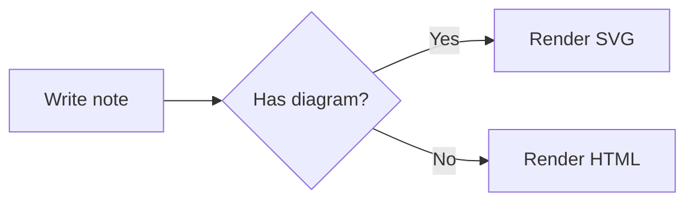

You can add diagrams to your notes using [Mermaid](https://mermaid.js.org/) syntax. Diagrams are rendered to SVG at build time with [Pele](https://pele.run), so no JavaScript is shipped to the browser. They automatically adapt to your theme and color scheme.

## Creating a diagram

Create a code block with the language `mermaid`:

````md

````


See the [Pele examples](https://pele.run/examples) for all supported diagram types, such as sequence diagrams, class diagrams, Gantt charts, and more.

> [!info] Invalid diagrams
> If a diagram contains invalid syntax, a warning is logged during the build and the diagram is shown as a regular code block instead.
